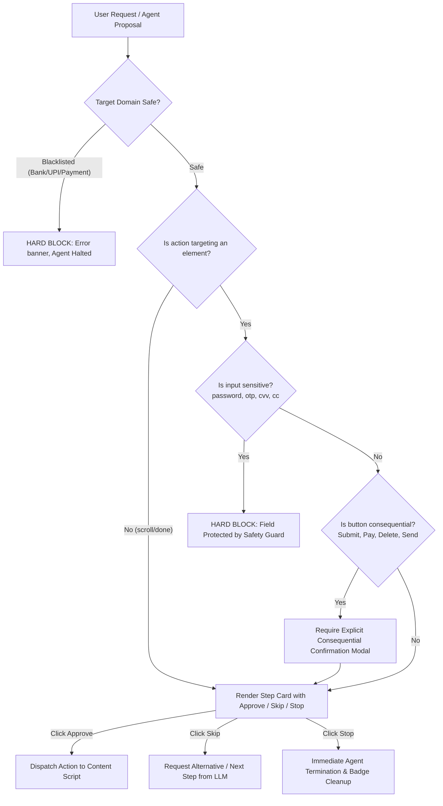

# Architecture & Technical Design: Siddarth AI Browser Agent

## 1. System Overview & Architectural Principles

Siddarth is built entirely around Chrome Extension Manifest V3, adhering to modern extension security, isolated execution scopes, and strict deterministic guardrails. The architecture emphasizes:

1. **Deterministic Safety over Probabilistic AI**: No model decides whether a page is safe; code-level regex and DOM inspection deterministically block unsafe actions.
2. **Explicit Human Gate**: The AI suggests an atomic action; execution happens strictly in response to a user click event in the extension UI.
3. **Stateless Service Worker & Persistent State Store**: Manifest V3 service workers are ephemeral. All critical agent state is stored in `chrome.storage.local` to survive suspension.
4. **Minimal Runtime Footprint**: Zero external bundling bloat; modular ES6 structure loaded cleanly via Chrome's native extension loader.
5. **Multi-Model Free-Tier Resilience**: Tiered fallback from Gemini Flash-Lite -> Gemini Flash (vision) -> Groq API (text fallback), handling HTTP 429 gracefully.

---

## 2. High-Level Component Topology

```mermaid
graph TD
    subgraph "Chrome Browser Host"
        subgraph "Active Web Page (Tab)"
            DOM[Target Webpage DOM]
            CS_Scanner[Content Script: Scanner & Badges]
            CS_Executor[Content Script: Action Executor]
            CS_Extract[Content Script: Readability Extractor]
            DOM <--> CS_Scanner
            DOM <--> CS_Executor
            DOM <--> CS_Extract
        end

        subgraph "Chrome Extension Core (Manifest V3)"
            SW[Background Service Worker<br/>background.js]
            ContextMenu[chrome.contextMenus]
            Storage[chrome.storage.local<br/>Keys, Profile, State, Skills]
            SW <--> ContextMenu
            SW <--> Storage
        end

        subgraph "Chrome Side Panel UI"
            SP_UI[Side Panel HTML/CSS/JS]
            Tab_Chat[Grounded Chat & Summary]
            Tab_Agent[Action Loop & Controls]
            Tab_Profile[User Profile & Skills]
            Tab_Settings[API Keys & Config]
            SP_UI --- Tab_Chat
            SP_UI --- Tab_Agent
            SP_UI --- Tab_Profile
            SP_UI --- Tab_Settings
        end
    end

    subgraph "External AI Services"
        Gemini[Google Gemini API<br/>Flash-Lite / Flash Vision]
        Groq[Groq API<br/>Llama 3 Fallback]
    end

    SP_UI <-->|chrome.runtime Messaging| SW
    SW <-->|chrome.tabs.sendMessage| CS_Scanner
    SW <-->|chrome.tabs.sendMessage| CS_Executor
    SW <-->|chrome.tabs.sendMessage| CS_Extract
    SP_UI <-->|Fetch API Direct / Proxy| Gemini
    SP_UI <-->|Fetch API Direct / Proxy| Groq
    SW -->|captureVisibleTab| SP_UI
```



---

## 3. Component Details & Directory Structure

```
ai-browser-masai-live/
├── manifest.json              # Manifest V3 configuration & permissions
├── background/
│   └── service-worker.js      # Context menus, tab lifecycle, message router
├── content/
│   ├── content.css            # Styles for badges, overlays, and highlights
│   ├── scanner.js             # Interactive element detection & badge rendering
│   ├── executor.js            # Safe synthetic event dispatching
│   └── readability-bundle.js  # Readability.js content extractor wrapper
├── sidepanel/
│   ├── index.html             # Side panel multi-view layout
│   ├── style.css              # Modern responsive styling & design tokens
│   ├── sidepanel.js           # Main UI controller & state machine
│   ├── tabs/
│   │   ├── chat.js            # Grounded chat, article & YouTube summary
│   │   ├── agent.js           # One-step-at-a-time agent approval loop
│   │   ├── profile.js         # Local profile management & skills import/export
│   │   └── settings.js        # API keys, model configuration & health check
├── lib/
│   ├── Readability.js         # Mozilla Readability source
│   └── marked.min.js          # Lightweight Markdown renderer for responses
├── utils/
│   ├── ai-client.js           # Gemini & Groq unified client + backoff handler
│   ├── safety-guard.js        # Deterministic domain & input safety enforcement
│   ├── storage-manager.js     # Typed wrappers around chrome.storage.local
│   └── youtube-parser.js      # YouTube video ID, transcript, & chapter parser
└── assets/
    ├── icons/                 # Extension icons (16, 32, 48, 128)
    └── mock-practice-pages/   # Offline test pages (internship form, shopping filter)
```

---

## 4. Communication Architecture & Message Protocol

All cross-boundary communication uses strongly-typed message payloads with the structure:
`{ type: string, payload: any, correlationId: string }`.

### Message Types Catalog

| Channel | Message Action | Purpose |
|---|---|---|
| Side Panel -> SW / Content | `SCAN_ELEMENTS` | Triggers DOM scan and requests structured element map |
| Content -> Side Panel | `ELEMENTS_SCANNED` | Returns numbered element metadata list |
| Side Panel -> Content | `HIGHLIGHT_ELEMENT` | Highlights a single element number (dry-run / find-it) |
| Side Panel -> Content | `EXECUTE_ACTION` | Dispatches approved action (`click`, `type`, `select`, `scroll`) |
| Content -> Side Panel | `ACTION_RESULT` | Returns outcome: success, DOM change observed, or error |
| Side Panel -> Content | `EXTRACT_PAGE_CONTENT`| Runs Readability on active tab and returns clean text |
| SW -> Side Panel | `CONTEXT_MENU_CLICKED`| Passes selected text and action (`explain`, `translate`, `reply`) |
| Side Panel -> SW | `CAPTURE_SCREENSHOT` | Calls `chrome.tabs.captureVisibleTab` and returns data URI |
| Any -> Storage | `SYNC_AGENT_STATE` | Persists agent step, conversation, and pending proposal |

---

## 5. Security & Safety Model (Deterministic Guardrails)



### Safety Rules Enforced in Code (`utils/safety-guard.js`):
1. **URL Blacklist Regex**:
   - Banking / Payments: `.*(bank|hdfc|sbi|icici|axis|kotak|paypal|stripe|razorpay|paytm|phonepe|gpay|upi).*`
   - Auth/Govt portals: Sensitive credential pages flagged for restricted operation.
2. **Element Safety Classification**:
   - Strictly forbidden inputs: `input[type="password"]`, `input[autocomplete*="cc-"]`, `input[name*="otp" i]`, `input[id*="cvv" i]`.
   - The executor throws a deterministic exception if requested to `type` into forbidden fields.
3. **Consequential Action Warnings**:
   - Action triggers matching `/submit|buy|order|pay|transfer|delete|remove|send/i` trigger a high-visibility warning badge requiring secondary confirmation.

---

## 6. Interactive Element Scanner & Badging Subsystem

1. **Candidate Selector**:
   - Identifies candidate interactive elements: `a[href]`, `button`, `input:not([type="hidden"])`, `textarea`, `select`, `[role="button"]`, `[role="link"]`, `[role="checkbox"]`, `[tabindex]:not([tabindex="-1"])`.
2. **Visibility & Occlusion Calculation**:
   - Uses `element.getBoundingClientRect()`.
   - Filters out non-rendered nodes (`display: none`, `visibility: hidden`, `opacity: 0`, `width === 0`, `height === 0`).
   - Ensures element or its center is visible in the viewport or document scroll area.
3. **Non-Intrusive Badge Rendering**:
   - Injected into a isolated top-level overlay `<div id="siddarth-badge-overlay">` with `pointer-events: none; position: absolute; z-index: 2147483647;`.
   - Each badge is an individual absolutely positioned element matching target coordinates `(rect.left + window.scrollX, rect.top + window.scrollY)`.
   - Numbering is consistent: Sequential indices `1, 2, 3... N` sorted in natural reading order (Y top-to-bottom, then X left-to-right).
4. **LLM Representation Serialization**:
   - Generates compact, token-efficient JSON:
   ```json
   [
     {"id": 1, "role": "link", "text": "Home"},
     {"id": 2, "role": "input_text", "label": "Full Name", "placeholder": "Enter name"},
     {"id": 3, "role": "button", "text": "Next Step"}
   ]
   ```

---

## 7. Agent Decision Engine & State Machine

### State Machine Lifecycle
```
[IDLE]
  │
  ▼ User submits task (e.g. "Fill this form from my profile")
[SCANNING_DOM] ──► Badges injected & compact DOM created
  │
  ▼
[REASONING_NEXT_STEP] ──► Gemini Flash-Lite / Groq called with strict JSON schema
  │
  ▼
[AWAITING_APPROVAL] ◄── User shown proposed step (Action, Target Badge, Value, Reason)
  │
  ├──► User clicks "Stop" ──► [IDLE] (Badges cleared)
  ├──► User clicks "Skip" ──► [REASONING_NEXT_STEP] (With feedback)
  └──► User clicks "Approve" (or "Dry-Run")
        │
        ▼
[EXECUTING_ACTION] ──► Synthetic event dispatched in Tab
  │
  ▼
[OBSERVING_DOM_CHANGE] ──► Check if goal reached or step limit hit
  │
  ├── If Goal Reached / Max Steps ──► [DONE]
  └── If Pending ──► [SCANNING_DOM] (Loop next step)
```

### Strict Output Schema
The model returns strictly valid JSON conforming to:
```json
{
  "action": "click" | "type" | "select" | "scroll" | "done",
  "targetId": 12,
  "value": "Jane Doe",
  "reason": "Filling full name input using user profile.",
  "isConsequential": false
}
```

---

## 8. Service Worker Resilience & Persistence Strategy

Manifest V3 background service workers enter inactive sleep after ~30 seconds without active event dispatches. To ensure zero task loss:
- The Side Panel acts as the primary runtime coordinator while open (DOM-based contexts do not sleep while visible).
- Any active task state is mirrored into `chrome.storage.local` under `siddarth_active_session`:
  ```json
  {
    "taskId": "task_1710000000",
    "tabId": 1234,
    "status": "AWAITING_APPROVAL",
    "currentStep": 3,
    "maxSteps": 10,
    "actionLog": [...],
    "pendingAction": { ... },
    "lastUpdated": 1710000020
  }
  ```
- When the side panel mounts or the service worker restarts, it checks `siddarth_active_session` and automatically restores the exact approval prompt and badge state.

---

## 9. Error Handling & Free-Tier Resilience Strategy

1. **HTTP 429 / Rate Limit Detection**:
   - Catches status code 429 from Gemini API.
   - Implements exponential backoff with jitter: retry at 1s, 2s, 4s.
   - If Gemini is depleted, automatically shifts to Groq endpoint for text-based reasoning tasks.
2. **Context Window Protection**:
   - Extracted article texts are clamped to 25,000 tokens.
   - Interactive element lists truncate non-interactive boilerplate, prioritizing inputs and actionable links.
3. **Safe Fallback UI**:
   - Non-technical user-friendly error banners with actionable remedies (e.g., "API quota reached. Please check your Gemini API key or switch to Groq in Settings").

